# Codex Loop Architecture

```mermaid
flowchart TD
  U[Codex Loop selected + exact user request] --> A[Mandatory lifecycle admission]
  A --> DRIVE[First invocation: current connected user My Drive]
  DRIVE --> PROFILE[Fixed codex-loop/settings/host-profile.json]
  PROFILE --> PREFER[Validate account and restore controller-only session profile]
  SAVE[User asks to remember a project] --> EDIT[host-project edits one source locator on controller]
  PREFER --> EDIT
  EDIT -->|Drive-backed| UPDATE[Export and update original Drive file ID + readback]
  UPDATE --> PROFILE
  PREFER --> RESOLVE[Controller selects connector using session profile]
  RESOLVE --> SNAP[One validated execution snapshot per conversation]
  SNAP --> LOOKUP[Selected environment locator from snapshot]
  LOOKUP --> CACHE[Selected connector verifies and materializes conversation cache]
  CACHE --> GRANT[Exact path authority + connector boundary]
  GRANT --> ACCESS
  GRANT -. WSL extra project .-> WREG[Owner-only local project allowlist]
  WREG --> WGRANT[Explicit user scope: idle-expiring bearer grant]
  WGRANT --> ACCESS
  WGRANT -. expiry or explicit revoke .-> WKILL[Stop grant commands; retain project files]
  DRIVE -->|Missing or unconnected| PROFILEFAIL
  PROFILE -->|Error or duplicate| PROFILEFAIL[Report recovery failure]
  PREFER --> S{Explicit target / saved default / Web}
  S -->|Web/default| HR[Installed ChatGPT runtime]
  S -->|Local computer| MCP[Explicit connector or ordered custom MCPs then RDC]
  MCP --> OBS[Host-observed file/shell capability + computer identity]
  OBS -. My Mac first admission .-> MG[Private Codex Loop runtime: route-init and bootstrap/resume; no project grant yet]
  MG --> LR
  MG -. explicit unrevoked authorization earlier in current chat; no task ID required .-> WG[workspace-admit: verify scoped root, materialize + grant current session]
  WG --> ROUTEGATE[Named My Mac route checks current session project grant]
  ROUTEGATE --> ACCESS
  ROUTEGATE -. missing or stale grant .-> REPAIR
  MCP -. first-time setup only .-> GUIDE[Local MCP setup tutorial]
  ROUTE --> DISPATCH[route-check uses snapshot and current task permissions]
  DISPATCH --> LR[Same connector: selected computer runtime cache]
  OBS -->|temporary transport failure| REPAIR[Same-chat scoped technical recovery]
  REPAIR -->|re-observe original connection| OBS
  REPAIR -->|grant or route rebuilt + verified| DISPATCH
  REPAIR -->|genuine external or authorization blocker| Z[Fail closed]
  REPAIR -. incident details .-> REPORT[Summarize fixed and unresolved errors at completion]
  OBS --> LOC[Controller supplies selected environment and project paths]
  LOC --> ROUTE[Private temporary route pins connection and environment, no native profile]
  ROUTE -. directory-dependent work .-> ROOT[Task directory / named project / environment default]
  ROOT -->|missing or denied| Z
  ROOT --> ACCESS[Host verifies task authority + real directory + connector roots]
  ACCESS --> DISPATCH
  DISPATCH -. transient failure or lost session .-> REPAIR
  HR --> L[bootstrap -> task_id]
  LR --> L
  A -->|known lifecycle| L
  A -->|identity/context lost| RR[resume same lifecycle]
  A -->|runtime temporarily unavailable| REPAIR

  L --> RQ[Retained exact request + steers]
  L --> PRE[Immediate live host write probes BEFORE source work: GitHub blob/tree/commit/ref, Drive upload/delete, local files]
  PRE --> LS{Lifecycle status}
  PRE -. recoverable permission or connector error .-> REPAIR
  LS -->|active| CC[Continuation contract]
  LS -->|paused| PA[Wait for explicit continuation]
  LS -->|blocked| BL[Wait for user/external change]
  LS -->|complete / cancelled| TERM[Terminal: never silently revive]
  PA -->|resume / continue| RR
  BL -->|resume / continue| RR
  RR --> RE[Reactivate resumable lifecycle
retain prior blocker for recheck]
  RE --> CC

  CC -. repo/filesystem work .-> O[One cheap orient]
  O --> GP{Normal Git probe succeeds?}
  GP -->|yes| RI[Root-to-cwd repo instructions]
  GP -->|yes| PW[Pre-existing dirty/protected paths]
  GP -->|no + registered project mapping| GMR[Validate host-local git metadata from Host Profile]
  GMR --> FIX[Repair shared .git pointer once + retry original probe]
  FIX --> RI
  FIX --> PW
  GP -->|no usable mapping| RI
  CC --> DS{Domain Skill owns workflow?}
  DS -->|no| H[Host-native agent loop]
  DS -->|yes| DW[Domain Skill-owned workflow/state]
  DW --> H
  RI --> H
  PW --> H

  H <--> T[Inspect / act / observe / test / repair]
  H -. same-host local parallel development .-> LC[Local Worktree DAG Collaboration]
  LC --> REG[Host-local SQLite: runs, workers, task keys/pools/deps, receipts, delegations]
  LC --> CW[Git: one authorized worktree per Chat task_id]
  REG --> READY[Compute Ready tasks from completed upstream keys]
  REG --> MUT[Worker publish or revise unclaimed DAG tasks; check graph revision]
  MUT --> READY
  READY --> QUAL[Filter excluded workers and producer self-review]
  REG --> RES[Optional run resource caps: shared groups across GPU pools]
  QUAL --> CAP[Atomic capacity filter: skip resource-full task pools]
  RES --> CAP
  EXEC -->|Resource acquisition failed before work| RB[Verify clean input HEAD; abort old isolation and atomically requeue]
  RB --> LEARN[Learn live peer concurrency; short zero-peer cooldown]
  LEARN --> RES
  CAP --> FAIR[Atomic fair claim: prioritize under-served eligible pools]
  FAIR -->|No eligible task| IDLE[Bounded wait: idle heartbeat every 30s, no claimed Slot]
  IDLE -->|Poll and check Ready| READY
  IDLE -->|Run closed / all tasks done| IDLEDONE[Idle Chat exits]
  CW --> FAIR
  FAIR --> LEASE[Atomic owner generation + 600 second last_seen lease]
  LEASE --> RECOVER{Reclaimed task?}
  RECOVER -->|No| ISOIN[Existing Logical Isolation: bind Run/Slot/lease and exact instructions]
  RECOVER -->|Yes| SNAP[Snapshot old HEAD, Git index, tracked patches and nonignored task files]
  SNAP -->|Consistent and conflict-free| RESTORE[Restore commits, staged edits and rebased internal links in NEW worktree]
  RESTORE --> ISOIN
  ISOIN -->|Ready, including full Slot instructions| EXEC[One Chat executes scoped work; review_of defaults read-only]
  ISOIN -->|Entry fails after claim| ISOHOLD[Keep claimed Slot and materialized files; retry same Run/task_id]
  ISOHOLD --> ISOIN
  SNAP -->|Changed/missing/conflicting| STOPREC[Pause recovery for manual reconciliation; preserve both worktrees]
  EXEC --> MCPHB[Scoped My Mac / WSL call: check inbox/control, heartbeat at most once per minute]
  MCPHB --> LEASE
  MCPHB -->|stop_task| STOPWORK[Block next operation, preserve worktree]
  LEASE -. inactivity at next claim .-> RC[Reclaim stale assignment; preserve old worktree; checkpoint optional]
  RC --> READY
  RC -. verified original finishes first .-> LATE[Atomic late finish: accept verified Git commit and send STOP]
  LATE --> STOPWORK
  LEASE -. explicit authorized force .-> RC
  EXEC -. activity .-> HB[Heartbeat / checkpoint]
  HB --> LEASE
  EXEC --> FIN[finish verifies own commit delta + Git cleanliness]
  FIN --> ISOEND[Writable closes on verified Git; read-only needs isolate-finish; strict semantic needs semantic-work-finish]
  ISOEND -->|Auto-claimed next Slot; retry recovers entire next-task scope| ISOIN
  FIN --> UNLOCK[Mark done and unlock downstream tasks immediately]
  UNLOCK --> READY
  FIN --> NEXT{Another Ready task?}
  NEXT -->|Yes| FAIR
  NEXT -->|No Ready and not Integrator| IDLE
  UNLOCK --> DEPS[Cross-worker dependency Git materialization: verified task deltas]
  DEPS --> ISOIN
  FIN --> ELECTION{All DAG tasks and delegations done?}
  ELECTION -->|No| READY
  ELECTION -->|Yes; atomic last-finisher| INTEG[Topological own-delta cherry-pick into clean target + tests]
  INTEG -. owner inactive, clean target verified .-> IRC[Reclaim integration / serial owner; no blind Git replay]
  IRC --> INTEG
  INTEG --> SERIAL{Prewritten serial tail registered?}
  SERIAL -->|Yes| AUTO[Atomic owner assignment to same Integrator task_id]
  AUTO --> STEPS[Same Chat executes full serial chain and distinct planned gates]
  STEPS --> GATE{All gates passed and target checkout clean?}
  GATE -->|No| HOLDTAIL[Keep owner active, repair via prewritten branch or block]
  HOLDTAIL --> STEPS
  GATE -->|Yes| CLOSE[serial-complete records final HEAD; unblocks lifecycle]
  CLOSE --> F
  SERIAL -->|No| F
  H -. live task-owned work .-> VW[Verified wait: observe existing handle]
  VW --> H
  H -. multi-step work only .-> P[Optional 3-state plan]
  P -. read-only projection .-> TB[Task board: doing / pending / done]
  H -. large/risky change only .-> Q[One Codex-style review]
  Q -->|finding| H
  Q -->|clean| F[Requirement -> current evidence
semantic acceptance]
  H --> F
  F -->|material work remains| H
  F -->|genuine impasse| BK[block --reason]
  BK --> BL
  F -->|requirements proven| CROOT{Completion root selection}
  CROOT -->|explicit cwd| EXROOT[Resolve caller-supplied repository]
  CROOT -->|omitted cwd + bound task| BROOT[Use task-pinned canonical root]
  CROOT -->|unbound task| LROOT[Lifecycle-only state]
  EXROOT --> D[One deterministic completion check]
  BROOT --> D
  LROOT --> D
  D -->|machine blocker| H
  D -->|PASS| E[status = complete]

  L -. cheap state-only query .-> N[next]
  N -. no status mutation / no reconciliation .-> LS
  L -. explicit correction .-> ST[Record exact steer]
  ST --> RQ
  L -. long/noisy transition only .-> C[Checkpoint / persistence]
  C -. restores same status + plan .-> LS

  DW -. authoritative semantic stage .-> SE[semantic-work-enter]
  SE --> LI[logical_isolation]
  LI --> SF[semantic-work-finish]
  SF --> SR[semantic_result_id
bound to stage + input + instruction + request + generation]
  SR --> DW

  H -. Local GitHub publication .-> GITAUTH[Apply saved nonsecret Git credential source to native push]
  PROFILE -. git_auth preference .-> GITAUTH
  GITAUTH --> GITPUSH[Push directly on selected host]
  GITPUSH -->|success + missing or stale source| GITSAVE[Controller export + update original Drive Host Profile + readback]
  GITSAVE --> PROFILE
  GITPUSH -->|clear auth failure| GITREPAIR[Diagnose then same-host credential fallback]
  GITREPAIR --> GITPUSH
  GITPUSH -->|ambiguous outcome| GITVERIFY[Inspect exact remote ref before retry]
  GITVERIFY --> GITPUSH
  GITPUSH --> G
  H -. consequential side effect .-> G[Routing / approvals / external-action reconciliation]
  G --> X[GitHub / Drive / Local / deployment]
  C -. durability/high-risk only .-> HD[Heavy baseline / fingerprints / durable validation / release lineage]
```

## Boundaries

- **Native Git authentication is host-owned.** The Drive Host Profile records the last successful nonsecret Git credential source for each environment. Native publication applies that source without preflight; clear authentication failures may select an already available same-host alternative. Only an authoritative successful push triggers Host Profile update and Drive readback, never token storage. Neither Git tokens nor SSH keys are retrieved or stored by Codex Loop.

- **Local collaboration is an adaptive DAG scheduler with a bounded lease, not a background Chat runtime.** The initial verified Git baseline and task identities remain stable, while an active worker may atomically publish tasks/pools and revise only unclaimed task definitions with a checked graph revision. SQLite filters explicit worker exclusions and producer self-review before assigning a ready task. An optional run-scoped shared-resource cap filters GPU-consuming pools before atomic fair selection, using the current claimed Slot count across all grouped pools. This does not interrupt existing claims, does not impose generic per-Pool quotas, and releases capacity when a Slot finishes or is reclaimed. Each worker has a private stable Worktree; no physical Slot path is reused after reclaim. A bounded foreground idle wait records separate SQLite waiter heartbeats and checks Ready every 30 seconds; it cannot wake or prove the liveness of a stopped Chat. No waiting heartbeat refreshes a claimed-task lease. A claim transaction reclaims assignments with no observed tool activity for 600 seconds; explicit force recovery still preserves the former Worktree, auditable ownership generation, and any verified checkpoint. The new owner must reconcile uncertain Git/external effects before repeating them. An installed My Mac/WSL MCP hook reports scoped host-tool activity, checks unread control, and throttles SQLite lease writes to one per 60 seconds. Uninstrumented tools and model thinking still need explicit activity reports. A reclaimed original worker may submit a verified late result if the successor remains unfinished; completed successor results are never overwritten. Last-finisher integration and tracked delegations remain protected by verified own-commit deltas and dependency ordering. An inactive integrator/serial owner can be reassigned after target Git state verification without blindly replaying interrupted merges. No daemon, cross-computer SQLite synchronization, authorization transfer or stopped-Chat wakeup is implied.

- **Detached HEAD continuity has explicit provenance.** Workers may use detached HEAD only when the recorded target branch is supported by verified source provenance; the workspace lease distinguishes `branch` (intended target) from `checked_out_branch` (None on detached workers). Unverified detached work is never silently promoted to HOT mutation authority.

- **The connected user Drive profile is the only persistent preference authority.** Each new conversation imports and verifies that profile exactly once on the controller. The controller resolves the selected connector and environment/project locators, passes an explicit execution snapshot to the local runtime, and the private conversation route pins it. Native runtime/task state is independent; no native host preference file participates.
- **Permission checks are early live operations, not connector status checks.** The GitHub Web publishing path should prewarm each actual write tool (`create_blob`, nonempty `create_tree`, unreferenced `create_commit`, same-SHA `update_ref`) before source changes; Drive upload/delete uses the actual `upload_file` and `delete_file` tools. UI popup timing remains host-owned, not inferable from API responses. After bootstrap/resume and route resolution, probe the access classes already required by the objective before substantive work. In particular, Drive deletion calls the real delete API only on a disposable newly created sentinel; local edits use the selected RDC/My Mac/My WSL write tool to create and clean up a file in the exact authorized project. Actual approval prompts and session-wide choices remain host-owned, and later sensitive actions may require fresh approval.
- **Technical errors remain visible after recovery.** Report distinct errors with cause certainty, repair, verified retry outcome and follow-up in the final task report; significant recurring errors also enter a normal checkpoint if one is needed. Reporting never pauses execution.
- **Recoverable technical faults do not end authorized work.** The agent re-observes the original selected connector, refreshes missing route/grant state from explicit unrevoked same-conversation authorization, resumes the existing lifecycle, verifies the original operation, and retries it safely. No new controller or persistent recovery service is introduced. Only a confirmed external dependency, revoked/absent authorization, or exhausted safe recovery path may block. Ambiguous side effects are reconciled before any replay.
- **My Mac admission grants are current-chat scoped.** Once `route-init` supplies a real session ID, an explicitly authorized project is admitted through one private-runtime `workspace-admit` command before ordinary project tools. Consent from any earlier user message in the current conversation remains effective for its exact project and action scope until revoked or narrowed; a missing technical grant is silently re-established under that consent, not re-asked. It checks the canonical path against a host-observed connector root, records a session-only grant, and needs no task ID. A continuation still resumes its existing lifecycle; no grant is silently inherited from an earlier conversation. The named connector retains its own access enforcement.
- **WSL temporary directories stay host-enforced.** The optional adapter has a private local project allowlist, separate from Host Profile locators. After explicit user authorization, the conversation receives a bearer grant reusable across tasks; only commands carrying that capability mount the extra project. Grant-backed execution/polling renews three days of idle validity; optional task labels do not bind authorization. The backend cannot identify the web chat, so the chat must retain its private capability. Protocol reconnection does not clear an unexpired grant, backend restart does. Expiry/revocation stops dependent commands and preserves durable files. Chat identity is not independently authenticated, and grants never enter saved preferences or shared task state. See `integrations/wsl-mcp/README.md`.
- **Lifecycle admission remains mandatory.** Once selected, Codex Loop must create or resume its lifecycle before any substantive task action. This invariant is not optimized away.
- **Exact user authority is canonical.** The initial request plus later steers define what the agent is authorized to do. A model-written task objective or acceptance restatement is not created for the same task.
- **Lifecycle status is explicit but thin.** `active | paused | blocked | complete | cancelled` controls whether work may proceed; it is separate from plan state. `paused` is user-driven, `blocked` requires a concrete impasse, and terminal states never silently resume.
- **The active loop is host-native.** After admission and any required one-time `orient`, ordinary inspection, editing, shell commands, tests, and repairs go directly through host tools. Codex Loop is not a workflow engine and does not sit between normal tool calls.
- **Domain workflows remain domain-owned.** If another selected Skill requires a workflow/state machine, Codex Loop keeps its lifecycle around that workflow but does not flatten or replace the Skill's states/transitions.
- **Authoritative domain semantic work has one execution path.** A coupled domain Skill may declare a stage as authoritative semantic work. That stage must enter `semantic-work-enter`, execute inside `logical_isolation`, and finish through `semantic-work-finish`. Only that path mints a `semantic_result_id`; generic delegation results, caller-authored PASS JSON, hashes, receipts, or domain helper scripts cannot substitute for it.
- **Semantic results are exact and fresh.** Each `semantic_result_id` is bound to consumer, stage, exact semantic input hash, governing instruction hash, effective user-request hash, and Codex Loop generation. `semantic-result` fails closed on a binding mismatch, on workspace mutation or a user steer during the isolation, or after a later mutation/steer makes the result stale.
- **Semantic-result persistence is structurally lossless.** Authoritative semantic JSON is sanitized without list/dict truncation, then checked against the total semantic-result byte limit. Oversized semantic results fail closed instead of silently dropping items; bounded structural scrubbing remains only for non-authoritative diagnostic/runtime state.
- **Logical isolation keeps its existing meaning.** It remains behavioral rather than physical context isolation. The new semantic authority contract does not claim cryptographic proof of cognition; it removes the domain-runtime bypass by making logical isolation the only Codex Loop path that can mint authoritative semantic work.
- **Normal model-facing context is authority-first and low-noise.** It contains the exact request/steers, a short continuation contract, lifecycle status, minimal workspace identity, real machine blockers/live work, and an optional short plan/task-board projection. Hashes, generations, validation history, changed-path inventories, receipts, and diagnostics remain runtime-side unless explicitly pulled or required by a capability.
- **`orient` is cheap.** Repository tasks establish repo identity, current branch/HEAD/status, applicable instructions, and pre-existing dirty paths without a full content fingerprint or repository-wide baseline.
- **Shared-worktree Git repair is bounded and failure-triggered.** A normal Git probe always runs first. Only when it fails, and only when the current path belongs to a Host Profile registered project whose environment defines `git_metadata_root`, Codex Loop validates `<git_metadata_root>/<project-alias>` as Git metadata for that exact worktree, updates its `core.worktree`, replaces the shared `.git` entry with the current-host pointer, preserves a conflicting synced `.git` directory outside the worktree, and retries the original probe once. My Mac/My WSL remain unchanged and repeated same-host Git access takes the normal fast path.
- **Scoped instructions are stable authority.** Load root-to-cwd instructions during orientation and load a deeper scope only before first touching it. Do not rediscover instructions as a heartbeat.
- **`next` is state-only.** It exposes status, plan/task-board state, and known live work without changing `paused`/`blocked`, reconciling the repository, hashing workspace content, rediscovering instructions, or suggesting that the model should finish. Use it only when a cheap lifecycle-state read is useful.
- **`resume` owns real re-entry and user continuation.** Active stays active; paused/blocked are reactivated as a new attempt to advance the same objective, with the prior blocker returned for mandatory re-observation; complete/cancelled cannot resume. After re-entry, re-observe the bound workspace, live work, and applicable instructions. Historical summaries or validation never outrank current reality.
- **Workspace recovery keeps the same lifecycle.** If a stale/legacy binding lacks enough Git identity to prove a move, `source-acquisition-verify --task-id` records stronger exact repository/commit/tree/origin evidence and `orient --rebind-verified` consumes it. Never bootstrap a replacement task or manually rewrite lifecycle state just to escape a workspace mismatch.
- **Plan is optional durable working memory.** Its only states are `pending | in_progress | completed`; the task board is a pure read-only projection of that same plan. Neither is authority or a deterministic completion blocker.
- **Validation is direct by default.** The host runs the smallest relevant test/build/lint check. Durable validation receipts exist only for explicit high-risk/durable workflows such as release/publication/persistence.
- **One semantic acceptance, one machine completion transition.** The model treats completion as unproven, derives material requirements from the request, and verifies them against current evidence. Only then does `completion` check machine-observable blockers; `PASS` transitions `active -> complete` without pretending the runtime certified semantic correctness.
- **Heavy reconciliation is lazy.** Full file baselines, ignored-file watches, workspace fingerprints, generation-based freshness, release lineage, and persistence are activated only when durable reconstruction or high-risk publication actually requires them.
- **Deterministic governance stays at real side-effect boundaries.** Non-idempotent external actions, routing, sandbox/approval, protected user work where durable tracking is active, workspace identity, and task-owned process cleanup remain explicit machine checks.
- **Drive temporary storage has one root.** All ChatGPT-created temporary Drive objects live under `ChatGPT-Temporary`; top-level Skill-named folders are reserved for intentionally retained archive content.
- **The host owns model sampling and normal tool execution.** Codex Loop does not recreate Codex's session runtime, token/budget manager, native multi-agent runtime, Plan Mode, Guardian/approval engine, tool dispatcher, or automatic idle-turn scheduler. No Composer DAG is introduced; the host-native agent loop remains the dynamic execution graph.

Host Profile recovery is independent of task resume. The host Drive connector owns authenticated transport; `host-profile` validates/imports/exports account-bound preference envelopes. Saved changes require provider read-back before claiming cross-chat durability. Fixed folder/file names are constants; private IDs never enter the Skill.

Local lifecycle dispatch has its own `local_lifecycle` route check, including bootstrap and resume. The host supplies the actual owning connector before dispatch; mismatches fail. This validates caller-provided identity, not interception of arbitrary host tool calls. Initialization recovery stays on the selected connector; only explicit user transition can change a pinned transport.

Environment identifiers represent distinct filesystems. Native runtimes do not independently restore or read Host Profile preferences. Missing or unreachable Drive profile blocks admission; no local/default preference fallback exists. Workspace project lookups read the route snapshot, and permissions remain separately scoped to this conversation. Project path changes take effect in a new conversation.
