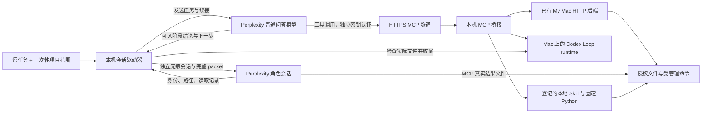

# Perplexity 普通问答接入 Mac 与 Codex Loop：完整教程

本教程记录一套在 Perplexity Mac 26.44.0 实际验证过的设置：继续使用 Perplexity 订阅里的普通问答模型，由本机程序推进多轮模型调用，通过 MCP 操作授权文件，并由 Mac 上的 Codex Loop 保存任务和完成状态。没有新增本地模型或模型 API 订阅。

## 先看日常怎么用

一次性保存项目目录和操作范围后：

1. 在 Perplexity 新建空白普通问答，选中 **Codex Loop Mac Skills** 连接器。
2. 双击接入目录的 **Write.command**。
3. 输入一句任务，例如：

```text
@epi prose /help
@epi prose /prepare
@epi prose /write Discussion
```

也接受 `@my mac@epi prose /write Discussion`；`@my mac` 是本地启动器的文字别名。**把短句输入 Write.command，不是在 Perplexity 输入框单独发送它。** 启动器负责加载实际本地技能、建立生命周期并推动后续问答。普通 `/write …` 仍是通用写作；只有显式 `@epi prose` 才加载 Epi Prose。

终端等价调用（在接入目录内）：

```sh
python3 shortcut.py run '@epi prose /help'
python3 shortcut.py run --project paper '@epi prose /write Discussion'
```

### 本地技能接入的实际范围

这个适配器读取本机登记的 Epi Prose 原始 `SKILL.md`、架构和按需资源，调用原始 Python 入口。安装中的 58 个顶层脚本均可登记；没有复制或删减技能知识库。Epi Prose 的 Interaction Intent、Composer、准备、生产、引文、审查和最终交付仍由原技能决定。短命令不代替项目材料和作者决定。

父会话调度；需要独立角色时，本地程序创建真正独立的 Perplexity 无痕会话。每个 actor 读完整规范 packet、manifest 分块和必读文件，保存真实结果；父会话只收身份、路径和读取记录，再调用原 runtime 的提交命令。B/T 不共用上下文，多视角依次完整执行，不冒称并行。原会话可按角色合同重用，失效则创建并记录新的真实身份。

Epi Prose 内层使用原有 native backend（参数历史名称 `--codex-native`），这里的执行者是 Perplexity 会话，并不启动 Codex 模型。外层始终是同一个 Codex Loop task_id。普通问答不是 Perplexity 原生 Skills 系统；本接入不依赖未验证的 Search Slash 自动分发。

当前已实际验证完整技能入口读取、真实 `/help`、两名独立无痕 actor 的 MCP 读写与返回，以及公开 HTML/PDF 原文存档与本地文本提取。**尚未做真实论文的完整 Epi Prose 生产验收**，不能把连接测试解释为所有写作路线或科学质量已通过。默认演示项目是测试目录；正式论文需另存真实项目范围和材料。

参考：[Perplexity 自定义远程连接器](https://www.perplexity.ai/help-center/en/articles/13915507-adding-custom-remote-connectors)、[无痕会话与记忆](https://www.perplexity.ai/uk/hub/blog/ai-memory)。

## 1. 理解各部分的职责



模型负责理解、写作、审查和决定下一步；程序负责发送、核对身份和范围、保存状态、检查实际产物。Codex Loop 本身不含模型。驱动器不会在 Mac 休眠、客户端不可用或会话关闭后凭空继续推理。

本接入是独立的 Perplexity 适配器，显式配置本机 runtime 和项目。它不加载或修改 ChatGPT 控制器的 Drive Host Profile，也不声称完整复刻 ChatGPT 的宿主能力。

## 2. 准备 Mac 和源码

需要：

- 已登录且可用的 Perplexity Mac 客户端，账户能添加远程自定义 MCP；本次实测版本为 26.44.0。
- Python 3.10+、提供 `node:sqlite` 的 Node.js（建议 22.13+）、Xcode Command Line Tools 的 `swiftc`、`cloudflared`。
- Mac 上现有 Codex Loop 源码/runtime，以及已验证的 My Mac 本地 HTTP 后端。

如果还没有 My Mac，先完成 [Mac 本地 MCP 设置教程](local-mcp-tutorial.md) 的本机文件和命令验收。这里要求的是本机 HTTP 适配器目录：含 `http-launch.json`（本机回环 URL 和凭证文件路径）、`package.json`，并且可解析 MCP SDK 和 AJV。**仅安装 Desktop Commander 的 stdio 包不能冒充这个前提**。需要先部署本地 HTTP 后端，再继续本教程；已有 My Mac 用户直接复用，不重建原 ChatGPT 隧道。

首次获取 Codex Loop 时可克隆到自己的选定目录；已有维护 checkout 应直接复用，不覆盖改动：

```sh
git clone https://github.com/yihan-hu/codex-loop.git
cd codex-loop/integrations/perplexity-mcp
```

安装缺少的常用命令可使用其官方安装方式。例如已有 Homebrew 时，`brew install node cloudflared`。`xcode-select --install` 会打开 Apple 的系统安装对话框，按提示完成；已有 `swiftc` 无需重装。Node 的实际 SQLite API 与后端依赖由下一步配置脚本现场检查。

## 3. 生成仅属于本机的配置

先创建或选定你授权的现有工作目录。把下面两个路径替换成真实绝对路径：

```sh
python3 configure.py \
  --my-mac-directory '/absolute/path/to/existing-my-mac-http' \
  --workspace '/absolute/path/to/authorized-project'
```

若 Node/cloudflared 不在 PATH，显式加 `--node '/absolute/path/to/node'`、`--cloudflared '/absolute/path/to/cloudflared'`。runtime 默认为本 checkout 的 `scripts/codex_loop.py`，可用 `--runtime-cli` 指定同一台 Mac 上的已验证安装。

配置脚本会检查前提、编译原生 UI helper，在本机 Application Support 创建或复用独立随机密钥，并生成：

- 接入目录的私有 `config.json`：机器路径和端口；Git 忽略它。
- `~/Library/Application Support/PerplexityCodexLoop/bin/perplexity-ui`。
- `~/Library/Application Support/PerplexityCodexLoop/state/project-example.json`：项目范围模板，只在首次创建时生成，避免覆盖你的配置。

默认本机监听 `127.0.0.1:31843`；更改端口可用 `--port`。密钥文件权限为 0600，不写入 Git、教程或日志。配置阶段不会启动或重启服务。

在 macOS「系统设置 → 隐私与安全性 → 辅助功能」中允许实际承载程序的应用（例如 Terminal；授权归属可能因启动方式不同而变化）。运行 helper 做只读检查：

```sh
"$HOME/Library/Application Support/PerplexityCodexLoop/bin/perplexity-ui" snapshot
```

输出应能识别 Perplexity 主会话窗口。若被系统拒绝，按系统设置授权后重试；不要把无权限误当成空白会话。程序不使用键盘或剪贴板作为隐式回退，也不调用 Perplexity 私有 HTTP 接口。

## 4. 启动本地服务和带密钥的 HTTPS 隧道

```sh
python3 manage.py start
python3 manage.py status
```

也可以双击 `Start.command`、`Status.command`。看到 `ready: true` 后，复制返回的 `mcp_url`，格式是 `https://…trycloudflare.com/mcp`。

Perplexity 26.44.0 的实测界面只提供远程 URL，没有旧教程里的本地 stdio 启动框，因此这里使用 Streamable HTTP + Cloudflare Quick Tunnel。**配置公网隧道意味着授权请求和结果会经过 Perplexity 与 Cloudflare**；使用前确认你允许该传输。所有 MCP/健康检查请求都要求独立密钥；未携带或错误密钥均拒绝。

launchd 只管理这个接入的 HTTP 和隧道两个服务，不重启原 My Mac/ChatGPT Tunnel。它们维持当前登录会话，不安装登录自启。Quick Tunnel 进程重新启动后域名会变，需要更新 Perplexity 的 URL；仅重启 HTTP 不会改变域名。稳定域名需要另行设置命名隧道，不能把临时 URL 当作永久服务承诺。

参考：[Cloudflare Quick Tunnel](https://developers.cloudflare.com/cloudflare-one/networks/connectors/cloudflare-tunnel/do-more-with-tunnels/trycloudflare/)。

## 5. 在 Perplexity 添加远程 MCP

在客户端的插件/连接器设置中添加自定义远程 MCP（具体菜单名可能随版本变化）：

- 名称：**Codex Loop Mac Skills**。
- MCP URL：上一节返回的完整 `https://…/mcp`。
- 认证：独立 API key/Bearer；若界面提供自定义请求头，使用 `Authorization: Bearer <独立密钥>`。
- 从本机私有文件安全地复制密钥到该认证框，保存后收起认证设置；不要贴进聊天或截图。

本机密钥位置是 `~/Library/Application Support/PerplexityCodexLoop/state/https-api-key`。连接成功后应发现 14 个工具，其中包括 `skill_read`、`skill_run`。普通问答输入框「更多选项 → 连接器」里还需要选中它；只安装而没有选中，并不代表当前会话可调用。

若旧连接器缓存了 12 个工具目录，可重新登记 **Codex Loop Mac Skills**，避免误以为服务缺少技能工具。服务升级无需到处创建重复连接器，先核对实际工具目录。

参考：[Perplexity 自定义远程连接器](https://www.perplexity.ai/help-center/en/articles/13915507-adding-custom-remote-connectors)。

## 6. 登记本地技能并保存项目

先登记现有 Skill 的真实安装目录和已经验证可用的 Python。登记不会下载安装另一套 Epi Prose：

```sh
python3 shortcut.py register-skill epi-prose \
  '/absolute/path/to/installed/epi-prose' \
  --python '/absolute/path/to/skill-venv/bin/python'
```

目录应有 `SKILL.md`、`ARCHITECTURE.md`、`scripts/`。安装中原有的外部资料符号链接会在登记时固定其实际目标，作为只读资源；改向后需重新由本机登记，模型不能自行扩大资源范围。解释器保留虚拟环境路径，不替换成脱离环境的系统 Python。按 Epi Prose 自身说明验证 spaCy、英文模型、pypdf 等所需依赖；缺少依赖应修复原环境，不能拿通用写作绕过。登记后重启本接入的 HTTP 进程使登记生效；已加载且源码路径不变时：

```sh
launchctl kickstart -k "gui/$(id -u)/local.yihan.perplexity-codex-loop.http"
```

编辑私有项目 JSON，例如 `paper.json`：

```json
{
  "workspace": "/absolute/path/to/authorized-paper-project",
  "goal": "项目范围模板；每次运行由用户短任务替换目标",
  "connector": "Codex Loop Mac Skills",
  "allowed_files": ["**"],
  "allowed_commands": [],
  "allowed_skills": ["epi-prose"],
  "required_files": [],
  "max_rounds": 512,
  "max_actors": 256,
  "min_rounds": 1,
  "round_timeout_seconds": 900,
  "max_approvals_per_round": 32
}
```

完整 Skill 会在项目内创建准备状态、运行目录和产物，因此运行入口要求明确授权整个项目 `allowed_files: ["**"]`。`required_files` 可填本次必须实际存在的交付物相对路径；不确定最终路线时可保持空列表，由原 runtime 负责科学交付，外层仍核对模型声明的产物。

登记的代码是受信任的本地程序，拥有当前 Mac 用户的进程权限。项目文件范围和固定 argv 是桥接约束，**不是操作系统沙箱**。`allowed_commands: []` 禁止另起任意 shell，但不会把受信任 Skill 代码的内部行为变成文件沙箱。

保存一次，之后只输入短任务：

```sh
python3 shortcut.py save paper '/absolute/path/to/private/paper.json' --default
python3 shortcut.py list
```

还可登记别的 Python Skill，并使用 `/skill:名称 用户请求`；这只提供相同的本地资源和入口接入，不能宣称未做宿主适配的 Skill 已验证全部功能。项目配置保存在本机私有 state，不提交 Git。

宿主另有两个固定 I/O 入口：`skill_run(script="@fetch", arguments=[公开URL, 项目原文路径])` 保存真实原文字节和来源记录，支持时提取文本；`@extract` 从项目内现有 PDF/DOCX 提取真实文本。原文下载只放到 `.epi-prose/literature-sources/`、`.epi-prose/plan-literature/`、`plan-literature/` 或 `.perplexity-sources/`。随后用 `skill_read` 完整分页读取文本。付费墙、扫描 PDF 无正文或网络失败必须如实处理，不生成假全文。这些入口不改变 Epi Prose 的来源准入标准。

## 7. 多轮执行、状态与恢复

启动返回 `run_id`、`task_id`、进程号和状态文件。固定协议由代码直接注入，用户不必每次写它。每轮由 Perplexity 真实完成阶段工作，再返回带随机轮次标记的 `CONTINUE`、`DONE` 或 `NEEDS_USER`；本地程序读取可见回答，发送模型提出的具体下一步。始终使用同一个 Codex Loop task_id。

自动 `yes` 只允许绑定会话、同任务、同轮的授权写入/编辑、固定 Skill 入口、精确白名单命令、同任务操作查询和检查点。新任务、提前收尾、其他文件及新增命令不会被自动批准。即使读操作不弹窗，也受到 MCP 桥接端同一文件范围的约束；符号链接不能绕开授权。一次只允许一个驱动器使用客户端。

运行期间让程序拥有 Perplexity 当前窗口；它会在父会话与自己的角色标签间切换，输入框不要放自己的草稿。切换会话、模型超时、超出轮数/批准次数、出现陌生确认或用户决策时会停在 `needs_attention`，不会伪报完成。

在接入目录执行（替换 RUN_ID）：

```sh
python3 conversation.py status RUN_ID
python3 conversation.py pause RUN_ID
python3 conversation.py resume RUN_ID
python3 conversation.py resume RUN_ID --instruction '作者对当前问题的实际答复'
python3 conversation.py cancel RUN_ID
```

- `pause` 阻止后续发送，不能撤回已经发出的消息和动作。
- `resume` 在前台继续同一个已暂停任务；先选回 `[PCL:RUN_ID]` 开头的原标签。恢复原会话/连接后才继续，不重新创建任务。
- 进程崩溃但状态仍为 running 时，确认旧进程已结束、原会话仍存在后，使用 `python3 conversation.py run RUN_ID` 接续观察。
- `cancel` 停止生命周期及受管理命令。若需改变目标或权限，当前版本应取消旧运行，更新项目配置，在新空白会话启动。`--instruction` 仅传递你实际写下的续接答复并保存到原生命周期，不增加文件或命令权限。

无痕角色的客户端会话有产品规定的有效期，不能保证原 UI 上下文永久存在；本地记录仍保留。恢复时若原角色会话已失效，按原技能合同报告并使用新身份。

逐轮可见回答、配置、状态和事件记录在 `~/Library/Application Support/PerplexityCodexLoop/state/conversations/RUN_ID/`；不会读取隐藏推理。最终先核对所需文件的实际存在、大小与 SHA-256，再尝试 canonical runtime 收尾。`PASS` 证明这些操作验收完成，不能独立证明科学或语义正确。

## 8. 验证与问题定位

配置完成、HTTP/隧道启动后，在接入目录运行：

```sh
python3 check-conversation.py
python3 check-actors.py
node skills.test.mjs
node check-http.mjs
```

前者检查任务/轮次绑定、文件/命令授权、符号链接、结果标记和真实文件检查；不调用模型。后者检查回环与 HTTPS 的缺失/错误密钥拒绝、认证后工具发现、真实状态调用及不受信任 Origin 拒绝。真实 UI/模型验收需要在客户端单独执行，不能用这些静态检查替代。

本实现曾从空白普通问答连续完成“初稿 → 实际读取并审查 → 实际读取并修订”三阶段：3 次模型任务发送、3 次程序范围内自动 yes、3 个实际文件写入、同一个 task_id，过程无手动确认或中途修复，最终 `complete / PASS`。终稿通过实际文件分词核对为 157 词。这是当前 Mac/客户端版本的实测，不是对未来版本的保证。

常见问题：

| 现象 | 处理 |
| --- | --- |
| 普通问答每步要求 yes | 单纯把工具权限设为“允许”仍可能被宿主确认；使用本教程驱动器，只批准已配置范围 |
| 输入 @Epi Prose 后并没有加载技能 | 在 Write.command 中输入；确认已经 register-skill、项目 allowed_skills 授权及 Skills 连接器选中 |
| 检测不到会话/输入框 | 检查 Accessibility 授权、Perplexity 主窗口与当前版本；不盲目自动按键 |
| 连接器已安装但程序拒绝启动 | 在空白问答的输入框中选中正确连接器，清空用户草稿 |
| 写入/读取不在授权范围 | 修改自己审阅的项目配置并重新保存；模型不能自行扩大授权 |
| 隧道显示新域名但暂时无法解析 | 检查 DNS 生效及 HTTPS 状态；脚本的 DoH 检查保留 TLS 校验，不使用跳过证书验证 |
| 重启后 URL 不同 | 把新的 MCP URL 更新到 Perplexity 原连接器 |
| 写操作结果不明 | 查询原 task/operation；复用原 request_id，不换 ID 盲重试 |
| 需要后台持续运行 | 电脑需唤醒且会话可用；本驱动器不会自动唤醒 Mac；初始父聊天由你打开，受管理角色聊天由程序创建 |

## 9. 只需要一次确定性批量操作时

不需要模型再次判断的明确步骤，可直接让 Perplexity 用一次 `loop_submit` 提交整批 `write_file / edit_file / read_file / list_directory / command / verify_file`。批准一次后，本地服务按持久清单执行并用只读 `loop_status(batch_id)` 查询。这与本教程的多轮模型驱动是两种不同任务形态；`loop_submit` 不包含模型，不能自动决定新的科学或写作方向。

## 10. 停止、升级和保密

`python3 manage.py stop` 或 `Stop.command` 只停止本接入的 HTTP/隧道，不关闭原 My Mac/ChatGPT 服务；先取消仍在运行的任务。不要把停连接误当成命令已被终止。

源码更新后保留私有配置，检查变化再重新运行配置/编译。`manage.py start` 不会替换已加载进程；若服务程序路径变化，需先停止再启动，随后更新可能改变的 Quick Tunnel URL。仅更换 HTTP 代码且路径不变时可重启 HTTP launchd 服务，保留隧道域名。

GitHub 中只保存源码和教程，不上传 `config.json`、项目配置、密钥、SQLite、会话日志或未授权的项目内容。官方 ChatGPT Skill ZIP 只包含运行时 allowlist；这个可选 Mac 接入目录从源码仓库使用，不在云端 Skill 包里运行。
